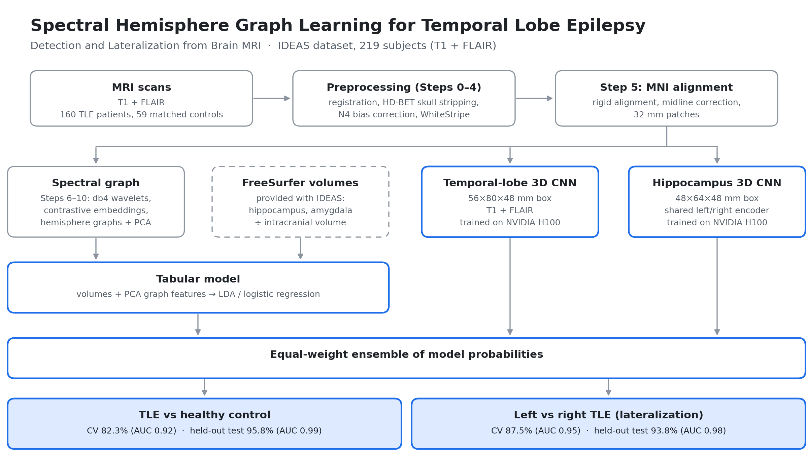

# Spectral Hemisphere Graph Learning for Temporal Lobe Epilepsy Detection and Lateralization from Brain MRI

Detects temporal lobe epilepsy (TLE) and the affected side from T1 + FLAIR brain MRI of the public
[IDEAS dataset](https://openneuro.org/datasets/ds005602) (219 subjects). A spectral hemisphere-graph
pipeline is combined with region-focused 3D CNNs (hippocampus and temporal lobe) and brain volumetry.



## Results

Development = repeated 5-fold cross-validation (5 repeats) on the development subjects.
Held-out = 44 subjects locked away before any modelling and evaluated once.

| Task | Final model | Development CV | Held-out test |
|---|---|---|---|
| TLE vs healthy control | temporal-lobe CNN + tabular | 82.3% ± 3.6, AUC 0.92 (94 subjects) | **95.8%**, AUC 0.99, 95% CI 88–100% (24 subjects) |
| Left vs right TLE | hippocampus CNN + temporal-lobe CNN + tabular | 87.5% ± 1.9, AUC 0.95 (128 patients) | **93.8%**, AUC 0.98, 95% CI 84–100% (32 patients) |

"Tabular" = LDA on hippocampus/amygdala volumes + PCA graph features (TLE vs control), logistic
regression on volume asymmetry (left vs right). Members are averaged with equal weights; the
combination was chosen by a rule fixed in advance (highest mean AUC). All metrics
(accuracy, sensitivity, specificity, PPV, NPV, F1, AUC, MCC, HS / non-HS subgroups) are in
[`results/`](results/).

## Pipeline

| Step | Script | What it does |
|---|---|---|
| 0 | `step0_select_subjects.py` | Temporal-lobe patients + controls matched on scanner, protocol, sex, age; writes `labels.tsv` |
| 1 | `step1_registration.py` | FLAIR → T1 affine registration (SimpleITK, Mattes MI), quality gate MI ≤ −0.35 |
| 2 | `step2_skull_stripping.py` | HD-BET brain extraction |
| 3 | `step3_bias_correction.py` | N4 bias field correction |
| 4 | `step4_intensity_normalization.py` | WhiteStripe normalisation (white-matter peak) |
| 5 | `step5_patch_extraction.py` | Rigid alignment to MNI152, midline correction, 32 mm patches (stride 16) |
| 6 | `step6_localized_spectral_decomposition.py` | 3D db4 wavelet (3 levels), 7 statistics per patch and channel |
| 7 | `step7_spectral_token_generation.py` | 14-number token per patch (T1 + FLAIR) |
| 8 | `step8_cross_scale_spectral_consistency.py` | Self-supervised cross-scale embedding (InfoNCE) |
| 9 | `step9_hemisphere_graph_construction.py` | One kNN graph per hemisphere |
| 10 | `step10_graph_representation_learning.py` | GAT (GraphCL) and PCA hemisphere vectors |
| 11 | `step11_adaptive_hemisphere_fusion.py` | Left/right fusion |
| 12 | `step12_lightweight_classifier.py` | TLE vs control classifiers (original baseline) |
| 13 | `step13_lateralization.py` | Left vs right classifiers (original baseline) |

Added models and evaluation:

| Script | What it does |
|---|---|
| `make_heldout_split.py` | Locks the 44 held-out subjects (`split` column in `labels.tsv`); refuses to run twice |
| `experiment_classifiers.py` | 9 classifiers × ~20 feature combinations |
| `experiment_volumetry.py` | FreeSurfer hippocampus/amygdala volume features and baselines |
| `gpu_attention_mil.py` | Attention MIL over all patches (tried, not kept) |
| `hippo_crops.py` | Hippocampus (48×64×48 mm) or temporal-lobe (56×80×48 mm, `TLE_BOX=temporal`) crops |
| `gpu_hippo_cnn.py` | Shared left/right 3D CNN on the crops + tabular model, out-of-fold predictions |
| `combine_oof.py` | Equal-weight ensembles, picks the highest AUC |
| `final_test.py` | Trains on all development subjects, evaluates the held-out set once |
| `lr_sweep_summary.py` | Learning-rate sensitivity of the CNNs |

## Setup

```bash
pip install -r requirements.txt        # install PyTorch for your platform first
```

Data (not in this repository):

1. MRI: [OpenNeuro ds005602](https://openneuro.org/datasets/ds005602) in BIDS layout (`sub-*/anat/`).
   `download_subjects.py` fetches the subjects listed by Step 0.
2. IDEAS metadata tables (patients and controls) used by Step 0; set their paths at the top of
   `step0_select_subjects.py`.
3. IDEAS FreeSurfer aseg tables (figshare `25612065.zip`), extracted to `fs_tables/`, for the
   volume features.

Paths are read from environment variables (defaults are in `pipeline_config.py`):

```bash
export TLE_DATA_ROOT=/path/to/ideas          # folder with sub-*/anat
export TLE_RUN_DIR=/path/to/ideas/run        # all outputs go here
```

## Running

```bash
python run_steps_0_to_4.py                   # Step 0 + downloads + Steps 1-4 (run_parallel.py: parallel shards)
for s in 5 6 7 8 9 10 11; do python step${s}_*.py; done
python step12_lightweight_classifier.py && python step13_lateralization.py

export TLE_VOL_DIR=fs_tables
python experiment_classifiers.py tle && python experiment_classifiers.py side
python hippo_crops.py 12 && TLE_BOX=temporal python hippo_crops.py 12
python gpu_hippo_cnn.py tle && python gpu_hippo_cnn.py side
TLE_CROP_DIR=temporal_crops python gpu_hippo_cnn.py tle && TLE_CROP_DIR=temporal_crops python gpu_hippo_cnn.py side
python combine_oof.py tle && python combine_oof.py side
```

`labels.tsv` already contains the held-out split, and the held-out evaluation (`final_test.py`) has
been run once; its results are in `results/`. Do not tune anything on the held-out subjects.

## Limitations

- Single dataset (one hospital, two GE scanners); no external validation yet.
- Small held-out set (24 / 32 subjects), so its confidence intervals are wide.
- Steps 8–11 and the PCA are fitted without labels on all subjects, held-out images included (transductive).
- Step 6 statistics pool all wavelet sub-bands and include the zero padding of `pywt.coeffs_to_array`;
  per-sub-band statistics are a planned improvement.

## Data citation

IDEAS is released under CC0. Please cite: Taylor et al., *The Imaging Database for Epilepsy And
Surgery (IDEAS)*, [arXiv:2406.06731](https://arxiv.org/abs/2406.06731).
